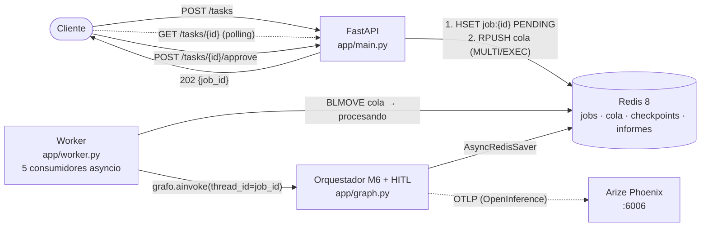
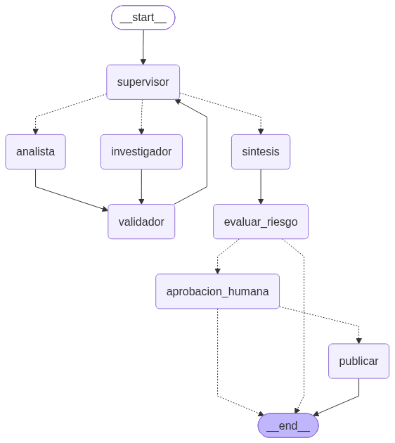
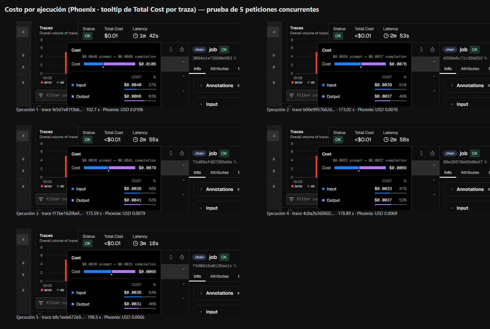
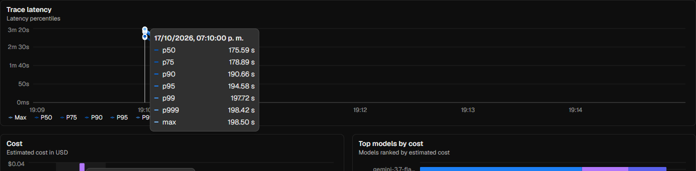
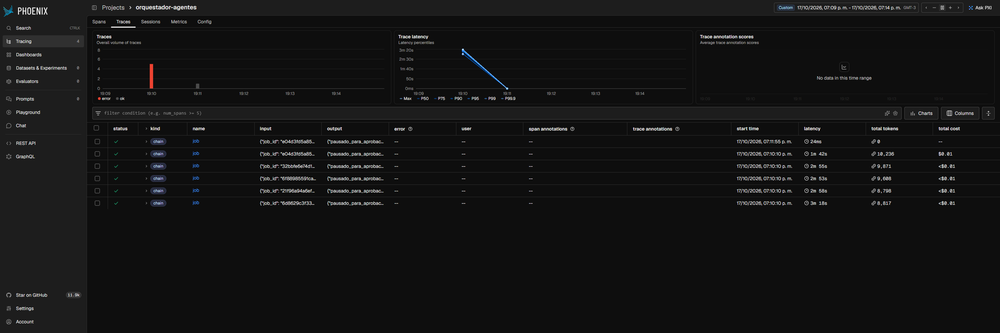
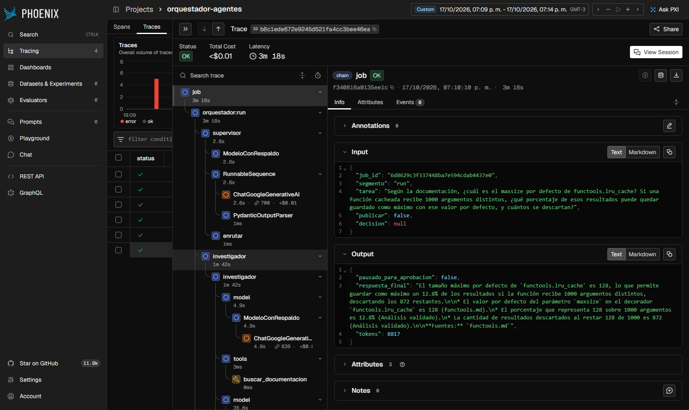
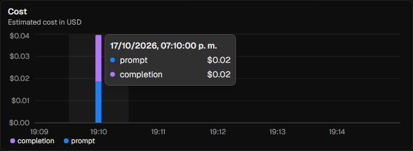
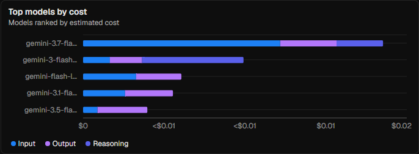
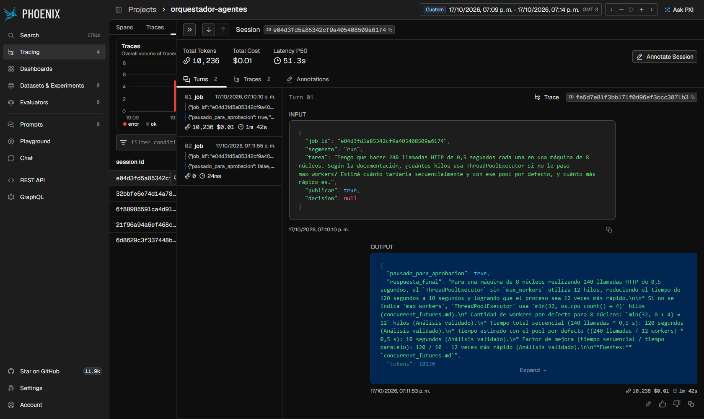
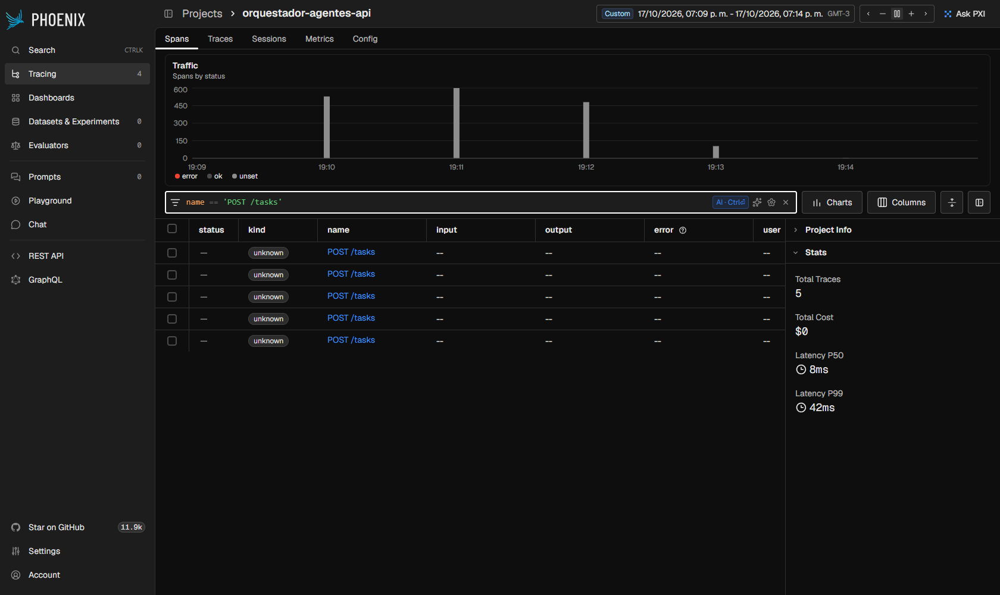

# Pre-entrega 7: API de producción y monitoreo activo

Curso AI Engineer (Coderhouse), Módulo 7: Producción y robustez (observabilidad, costos y despliegue).

Este repo expone el **orquestador multi-agente de la Pre-entrega 6** (Supervisor + Investigador con RAG en Pinecone + Analista con calculadora + Validador determinístico) detrás de una **API REST asíncrona con FastAPI**:

- **No bloquea:** `POST /tasks` registra el job, lo encola en **Redis** y devuelve un `job_id` en milisegundos. Un **worker** separado ejecuta el grafo y el cliente consulta el estado por polling.
- **Redis** guarda el estado de los jobs (`PENDING → RUNNING → AWAITING_APPROVAL → DONE / REJECTED / FAILED`), la cola y los **checkpoints de LangGraph** (`AsyncRedisSaver`).
- **Arize Phoenix** (OpenInference/OpenTelemetry) traza cada job, cada nodo del grafo, cada llamada al LLM y cada herramienta, con tokens, costo y latencia.
- **Human-in-the-loop:** el grafo se **detiene con `interrupt()`** antes de cualquier acción crítica y solo sigue cuando llega `POST /tasks/{id}/approve`.

## Arquitectura



El grafo es el del Módulo 6 más la "cola" de Human-in-the-loop (diagrama exportado con `draw_mermaid_png()`):

<p align="center"></p>

## Estructura del repo

```
.
├── app/
│   ├── main.py            # FastAPI: POST /tasks (encola) · GET /tasks/{id} · /checkpoints · /informes · /health
│   ├── graph.py           # orquestador del M6 + nodos HITL + AsyncRedisSaver (checkpointer de Redis)
│   ├── worker.py          # consume la cola, corre el grafo y actualiza el estado (PENDING/RUNNING/.../FAILED/DONE)
│   ├── jobs.py            # JobStore en Redis: hash por job, cola confiable, aprobación atómica (WATCH)
│   ├── observability.py   # Phoenix (register + LangChainInstrumentor), decorador @trazado, conteo de tokens
│   ├── hitl.py            # evaluar_riesgo → aprobacion_humana (interrupt) → publicar · POST /tasks/{id}/approve
│   └── schemas.py         # contratos de la API
├── agents/ rag/ state.py  # núcleo multi-agente de la Pre-entrega 6 (state.py extendido con campos HITL)
├── config.py · llm.py     # configuración por .env · modelo por rol con modelos de respaldo
├── scripts/
│   ├── prueba_carga.py    # 5 peticiones concurrentes + polling + p50/p95 del lado cliente
│   ├── metricas_phoenix.py# costo por ejecución, p95 y desglose por nodo, leídos de la API de Phoenix
│   └── capturas_phoenix.py# regenera screenshots/ con Playwright
├── tests/                 # 49 tests offline + 1 de integración con Redis real
├── screenshots/           # capturas del dashboard de Phoenix (evidencia)
├── resultados/            # JSON de la prueba de carga y de las métricas de Phoenix
├── docker-compose.yml     # redis + phoenix + api + worker
├── Dockerfile · requirements.txt · .env.example
```

## Cómo levantarlo

### Opción A: todo con Docker Compose (recomendada)

```bash
cp .env.example .env        # completá GOOGLE_API_KEY (y PINECONE_API_KEY si querés el RAG en la nube)
docker compose up --build -d
```

| Servicio | URL |
|---|---|
| API (Swagger) | http://localhost:8000/docs |
| Phoenix | http://localhost:6006 |
| Redis | `localhost:6379` |

`docker compose logs -f worker` muestra lo que hace el worker.

### Opción B: Redis y Phoenix en Docker, API y worker local

Requiere **Python 3.12+** (probado con 3.12 en Docker y 3.14 local).

```bash
docker compose up -d redis phoenix                 # Redis 8 (trae RedisJSON + RediSearch) y Phoenix
python -m venv .venv
.venv\Scripts\Activate.ps1                         # Windows (Linux/Mac: source .venv/bin/activate)
pip install -r requirements.txt
cp .env.example .env                               # completá las claves

python -m app.worker                               # terminal 1: worker (5 consumidores)
uvicorn app.main:app --port 8000                   # terminal 2: API
```

> El checkpointer `AsyncRedisSaver` necesita **Redis 8** o **Redis Stack**, porque usa los módulos JSON y Search. Un Redis 7 "pelado" no alcanza.
> Para desarrollo rápido, `WORKER_EMBEBIDO=true` levanta los consumidores dentro del proceso de la API (sin `python -m app.worker`).

Sin `PINECONE_API_KEY`, el Investigador usa un BM25 local sobre los mismos documentos (`RESEARCH_BACKEND=auto`). Si es la primera vez con Pinecone: `python ingest.py`.

### Probar la API a mano

```bash
# 1. Encolar (responde 202 al instante con el job_id)
curl -X POST localhost:8000/tasks -H "Content-Type: application/json" \
  -d '{"tarea": "Segun la documentacion, cual es el maxsize por defecto de functools.lru_cache? Si una funcion recibe 1000 argumentos distintos, que porcentaje puede quedar cacheado?", "publicar": true}'

# 2. Polling del estado
curl localhost:8000/tasks/<job_id>

# 3. Como pidió publicar, queda en AWAITING_APPROVAL con el borrador y los motivos: aprobar o rechazar
curl -X POST localhost:8000/tasks/<job_id>/approve -H "Content-Type: application/json" \
  -d '{"aprobado": true, "revisor": "juani", "comentario": "OK"}'

# Extra
curl localhost:8000/tasks/<job_id>/checkpoints     # historial de checkpoints de LangGraph guardados en Redis
curl localhost:8000/informes                      # informes publicados (el efecto secundario aprobado)
curl -X POST localhost:8000/tasks -H "Content-Type: application/json" \
  -d '{"tarea": "tarea que va a fallar a proposito", "simular_falla": "excepcion"}'   # -> FAILED
```

## Prueba de carga: 5 peticiones concurrentes

```bash
python scripts/prueba_carga.py --con-hitl     # 5 tareas a la vez; la 1ra pide publicar y el script la aprueba
python scripts/metricas_phoenix.py            # costo por ejecución, p95 y desglose por nodo (API de Phoenix)
python scripts/capturas_phoenix.py            # opcional: regenera screenshots/ (pip install playwright)
```

`prueba_carga.py` manda las 5 peticiones con `asyncio.gather`, hace polling de cada job hasta un estado terminal y guarda `resultados/carga_<fecha>.json`. `metricas_phoenix.py` toma la ventana de tiempo de esa corrida y consulta a Phoenix.

### Resultado de la corrida incluida (17/10/2026)

| Job | Estado | `POST /tasks` | Punta a punta | Tokens | Costo (Phoenix) |
|---|---|---|---|---|---|
| 1 (pide publicar → HITL → aprobado) | DONE | 46 ms | 106,8 s | 10.236 | USD 0,0106 |
| 2 | DONE | 12 ms | 199,3 s | 8.817 | USD 0,0066 |
| 3 | DONE | 16 ms | 179,2 s | 8.798 | USD 0,0069 |
| 4 | DONE | 17 ms | 173,2 s | 9.608 | USD 0,0076 |
| 5 | DONE | 18 ms | 177,2 s | 9.871 | USD 0,0079 |

**Métricas de Phoenix** ([`resultados/metricas_phoenix_20261017_191341.json`](resultados/metricas_phoenix_20261017_191341.json)):

- **Costo por ejecución: USD 0,0079 en promedio** (mínimo 0,0066, máximo 0,0106). Total de la corrida: USD 0,0396 por 47.330 tokens (39.438 de entrada y 7.892 de salida). Phoenix lo calcula solo, con los tokens de cada llamada al LLM y su tabla de precios por modelo.
- **Latencia p95 por ejecución: 194,6 s** (p50 175,6 s, p99 197,7 s).
- **La API no se bloquea:** `POST /tasks` tiene p50 = 8 ms y p99 = 42 ms en Phoenix (proyecto `…-api`), mientras el worker procesa 5 grafos a la vez.

### Lectura del dashboard

- **Dónde se concentra la latencia.** El 90 % del tiempo de los nodos está en **supervisor (45 %)** e **investigador (45 %)**. El analista ocupa el 9 % y la síntesis menos del 1 %. Con una sola tarea, el job tarda 34 s. Con 5 concurrentes, cada job tarda ~175 s. Las 5 tareas compiten por los mismos modelos y el free tier de Gemini limita requests por minuto, así que la latencia de los nodos que más llaman al LLM se multiplica. En producción esto se resuelve con un plan pago o con un límite de concurrencia por modelo (un `Semaphore` por proveedor).
- **Qué nodo consume más tokens.** El **investigador (41 % de los tokens, USD 0,0179 de los 0,0396)**: es un sub-agente ReAct que mete en el contexto los fragmentos recuperados de Pinecone y además razona (tokens de *reasoning*, que se ven en "Top models by cost"). Le siguen el **supervisor (27 %)**, que se invoca 3 veces por tarea, y el **analista (24 %)**. Para bajar el costo convendría recortar los fragmentos que se le pasan al investigador o usar un modelo *lite* para el supervisor.
- **Errores que no llegan al usuario.** El gráfico de trazas marca en rojo la corrida aunque los 5 jobs terminaron OK. Phoenix muestra 22 spans con error: el supervisor agotó la **cuota diaria** de `gemini-3-flash-preview` (9 veces) y el investigador chocó con el **límite por minuto** de `gemini-3.7-flash` (4 veces). En todos los casos, `ModeloConRespaldo` (`llm.py`) siguió con el modelo de respaldo (`gemini-flash-lite-latest`). Es el "éxito silencioso" del módulo: sin trazas no se vería.
- **HITL y costo.** La traza del job 1 tiene dos segmentos en la misma sesión (`session.id = job_id`): la corrida (1 min 42 s, 10.236 tokens) y la reanudación tras la aprobación (24 ms, 0 tokens). La espera humana no consume ni tokens ni worker.

### Capturas (`screenshots/`)

| | |
|---|---|
| **Costo por ejecución**: tooltip de *Total Cost* de cada una de las 5 trazas<br> | **Latencia p95**: percentiles por traza (p95 = 194,58 s)<br> |
| **Trazas de la prueba de carga**: 5 corridas + 1 reanudación HITL<br> | **Detalle de una traza**: job → grafo → nodos → LLM / tools / retrievers<br> |
| **Costo estimado** (prompt + completion)<br> | **Costo por modelo** (input / output / reasoning)<br> |
| **Sesión del job con HITL**: corrida + reanudación<br> | **Latencia de la API**: `POST /tasks` p50 8 ms / p99 42 ms<br> |

Otras: [proyectos](screenshots/01_proyectos_phoenix.png), [dashboard de métricas completo](screenshots/04_metricas_dashboard.png), [sesiones por job](screenshots/08_sesiones_por_job.png).

## Cómo cumple la consigna

### 1. Orquestación asíncrona y API

| Requisito | Implementación |
|---|---|
| Recibir, encolar y devolver un ID | `POST /tasks` → `JobStore.crear_y_encolar()`: `HSET job:{id}` (PENDING) + `RPUSH cola:tareas` **en una transacción MULTI/EXEC**, en ese orden. Responde **202** con el `job_id` sin tocar el LLM. |
| No bloquear el event loop | Todo usa `redis.asyncio`, `ainvoke` del grafo y del LLM, y `AsyncRedisSaver`. Las herramientas síncronas de los agentes (búsqueda en Pinecone/BM25) LangChain las corre en un thread pool, y el RAG se carga con `asyncio.to_thread`. Ningún endpoint ejecuta el agente. |
| Patrón Worker | Proceso separado (`python -m app.worker`, servicio `worker` del compose) con **5 consumidores asyncio**. La cola es **confiable**: `BLMOVE` pasa el mensaje a `procesando:{worker}` y se borra recién al terminar. Si el worker muere, al reiniciar re-encola lo que quedó a medias. |
| Polling | `GET /tasks/{id}` devuelve estado, resultado, aprobación pendiente, tokens, costo estimado y error. `404` si no existe. |

### 2. Persistencia con Redis

| Requisito | Implementación |
|---|---|
| Estado del job | Hash `job:{id}` con TTL (7 días). Estados `PENDING`, `RUNNING`, `AWAITING_APPROVAL`, `DONE`, `REJECTED` y `FAILED`. |
| **FAILED ante una excepción** | `Worker.procesar()` envuelve la ejecución en `try/except` + `asyncio.wait_for(timeout)`: **cualquier** excepción o timeout deja el job en `FAILED` con el error, y el polling del cliente termina. Se ve en [`resultados/FAILED_cuota_agotada_20261017_185935.json`](resultados/FAILED_cuota_agotada_20261017_185935.json): una primera corrida en la que se agotó la cuota de Gemini terminó con los 5 jobs en `FAILED` y el error 429 guardado, sin ningún cliente colgado. |
| Checkpoints de LangGraph | `AsyncRedisSaver` (`langgraph-checkpoint-redis`) con `thread_id = job_id` y TTL. **Un worker pausa y otro reanuda**: el job queda en Redis aunque se reinicie el proceso (lo cubre `tests/test_redis_integracion.py` contra Redis real: un grafo pausa y otro grafo, con otra conexión, reanuda). `GET /tasks/{id}/checkpoints` lista el historial (paso, canales actualizados). |
| Serialización segura | LangGraph solo reconstruye desde JSON las clases que se permiten explícitamente. Se habilitan **solo** los modelos de `state.py` (`allowed_json_modules`), no `True`. Sin esto, al reanudar los modelos Pydantic volvían como `dict` y el nodo HITL fallaba. Ese bug apareció al matar el worker con un job pausado y reanudarlo con otro proceso (los tests en memoria no lo detectaban), y ahora hay un test que lo cubre. |

### 3. Observabilidad (Arize Phoenix)

| Requisito | Implementación |
|---|---|
| Instrumentación | `phoenix.otel.register()` (exporter OTLP en batch) + `LangChainInstrumentor` de OpenInference: spans de cada nodo, sub-agente, LLM (con tokens de entrada/salida/reasoning), herramienta y retriever. |
| Decoradores | `@trazado(...)` en `app/observability.py`: span raíz `job` por cada segmento del worker (con input/output legibles) y span `TOOL` para `publicar_informe`. |
| Contexto de la traza | `session.id = job_id`, `metadata` (job, segmento, modelos por rol, **versión del prompt del supervisor**) y `tags`. La corrida y la reanudación HITL quedan en la misma sesión. |
| Métricas limpias | La API manda a un proyecto aparte (`orquestador-agentes-api`): FastAPI emite un span por request y los cientos de GET de polling ensuciarían la p95 del agente. |
| Costo y p95 | Ver la sección de la prueba de carga y las capturas. `metricas_phoenix.py` lee los mismos números de la API GraphQL de Phoenix. |

LangSmith también está soportado: `OBSERVABILIDAD=langsmith` + `LANGSMITH_API_KEY`.

### 4. Human-in-the-loop

```
sintesis → evaluar_riesgo ─(crítica)→ aprobacion_humana ⏸ interrupt() ─(aprobada + publicar)→ publicar → END
                          └─(no crítica)→ END                          └─(rechazada)→ END  (job REJECTED)
```

Una tarea es **crítica** si:
1. **Efecto secundario:** pide `publicar=true`. El nodo `publicar` escribe el informe en un Stream de Redis compartido (`informes:publicados`), algo irreversible. Es **idempotente** (`SET NX` con el `job_id`): un reintento no publica dos veces.
2. **Escalamiento:** el supervisor del M6 marcó `requiere_revision_humana` (un especialista agotó sus intentos).
3. **Costo alto:** la corrida superó `HITL_MAX_TOKENS` o `HITL_MAX_COSTO_USD`.

Detalles de diseño:
- La **evaluación** (`evaluar_riesgo`) y la **pausa** (`aprobacion_humana`) son nodos separados. Al reanudar, LangGraph re-ejecuta el nodo que llamó a `interrupt()`. Si ese nodo recalculara el riesgo (por ejemplo, con un contador de tokens que en el nuevo proceso arranca en 0), la decisión podría cambiar. El veredicto queda en el checkpoint.
- La pausa **no ocupa un worker**: el job queda en `AWAITING_APPROVAL` con el borrador, los motivos y el costo hasta ese momento. La reanudación la puede tomar cualquier worker.
- `POST /tasks/{id}/approve` usa `WATCH`: dos aprobaciones simultáneas no reanudan el grafo dos veces (la segunda recibe **409**). Aprobar un job que no está esperando también da 409.

### 5. Free tier de Gemini: modelo por rol + respaldo

El free tier de Gemini permite ~20 requests **por día y por modelo**, y una tarea usa ~9 llamadas. Para que entren las 5 concurrentes sin pagar:
- **Un modelo por rol** (`LLM_MODELO_SUPERVISOR`, `_INVESTIGADOR`, `_ANALISTA`, `_SINTESIS`): reparte la carga entre cuotas independientes. Además es una práctica de producción: un modelo *lite* para la síntesis y uno más capaz para el ruteo.
- **Modelos de respaldo** (`LLM_MODELOS_RESPALDO`): `ModeloConRespaldo` en `llm.py` es un `RunnableWithFallbacks` que aplica `bind_tools` y `with_structured_output` a todos los modelos. Si uno devuelve 429, la llamada sigue con el siguiente. En la corrida incluida salvó 13 llamadas.

## Tests

```bash
python -m pytest -q          # 49 tests offline (LLM guionado + fakeredis), sin API keys
docker compose up -d redis   # + 1 test de integración con Redis real (se saltea si no hay Redis)
```

Cubren: los 32 tests del orquestador de la PE6; que el `POST` encole sin ejecutar el agente; el flujo completo hasta DONE; HITL por API (pausa, 409 si se aprueba antes de tiempo o dos veces, aprobación, publicación, rechazo → REJECTED); **FAILED** por excepción, por error dentro del grafo y por timeout; la cola confiable; la idempotencia de la publicación; los criterios de criticidad por costo y por escalamiento; el modelo de respaldo con el grafo entero; y la reanudación desde Redis en otro "worker".

## Variables de entorno principales

| Variable | Default | Para qué |
|---|---|---|
| `REDIS_URL` | `redis://localhost:6379/0` | Estado, cola y checkpoints |
| `WORKER_CONCURRENCIA` | `5` | Consumidores por worker |
| `JOB_TIMEOUT_SEGUNDOS` | `900` | Pasado ese tiempo → FAILED |
| `OBSERVABILIDAD` | `phoenix` | `phoenix` \| `langsmith` \| `none` |
| `PHOENIX_COLLECTOR_ENDPOINT` | `http://localhost:6006` | Colector de Phoenix |
| `HITL_MAX_TOKENS` / `HITL_MAX_COSTO_USD` | `60000` / `0.05` | Umbrales de "costo alto" |
| `LLM_MODELO_<ROL>` / `LLM_MODELOS_RESPALDO` | `LLM_MODEL` / vacío | Modelo por rol y respaldos |
